# VYBE Social Tournament Platform — High-Level Design

**Version:** 1.0
**Status:** Draft
**Event:** Bring Your Own Team (BYOT), 21 October 2026
**Stack:** Next.js App Router + TypeScript · Supabase · Vercel · Tailwind CSS

---

## 1. System Context

The platform serves three actors against a single-page tournament system:

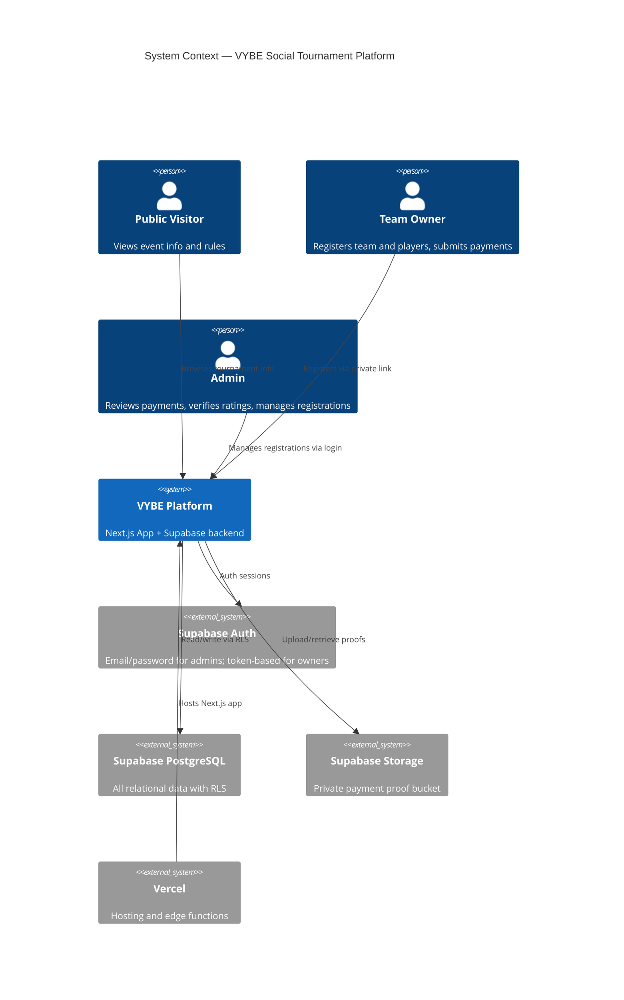

---

## 2. Component Architecture

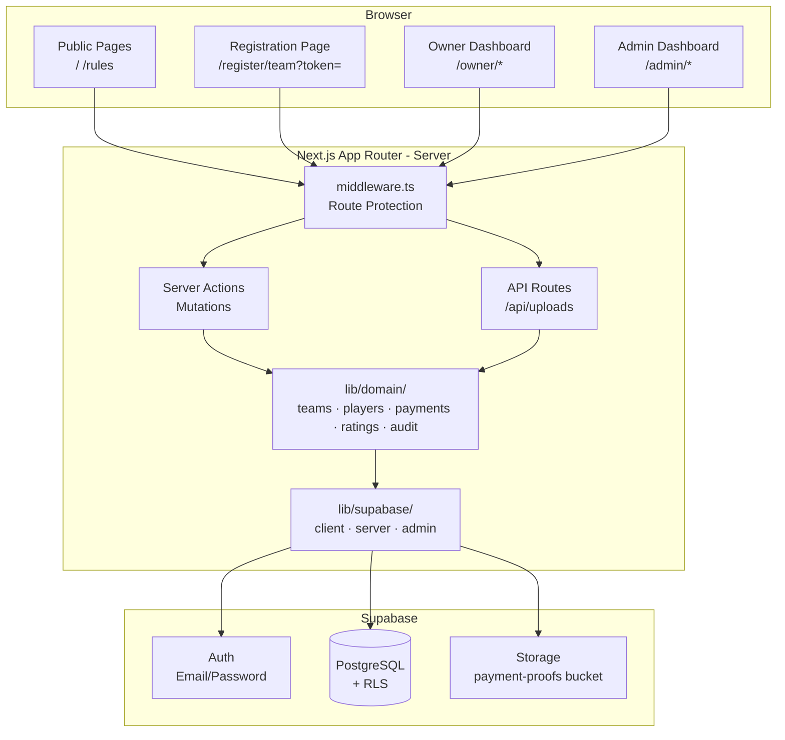

### Component Responsibilities

| Component | Responsibility |
|---|---|
| `middleware.ts` | Enforce session on `/owner/*` and `/admin/*`; verify admin role for `/admin/*` |
| `lib/supabase/client.ts` | Browser-side Supabase client using anon key |
| `lib/supabase/server.ts` | Server-side client using anon key + user session cookie |
| `lib/supabase/admin.ts` | Service-role client — **server-only**, never imported client-side |
| `lib/domain/teams.ts` | `createTeamRegistration()`, `confirmTeam()`, `waitlistTeam()` |
| `lib/domain/players.ts` | `addPlayer()`, `addPlayersBatch()`, `removePlayer()`, `replacePlayer()` |
| `lib/domain/payments.ts` | `submitPaymentProof()`, `approvePayment()`, `rejectPayment()` |
| `lib/domain/ratings.ts` | `verifyPlayerRating()`, `effectiveDupr()`, `teamCumulativeDupr()` |
| `lib/domain/audit.ts` | `log(actor, action, entity, details)` — append-only |
| `lib/tokens.ts` | `generateToken()`, `validateToken()` — for private registration links |

---

## 3. Data Model (ERD)

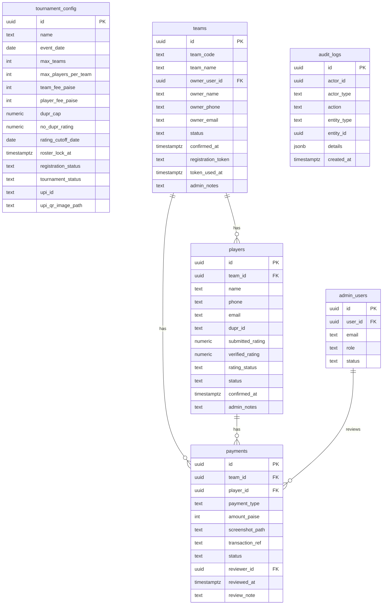

---

## 4. Key User Flows

### 4.1 Team Owner Registration (Private Link Flow)

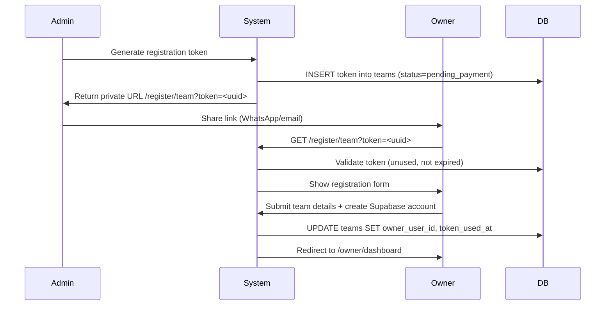

### 4.2 Team Payment Submission

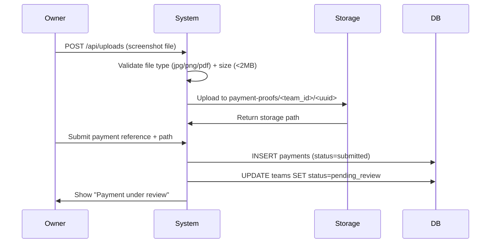

### 4.3 Team Payment Approval (Atomic Capacity Check)

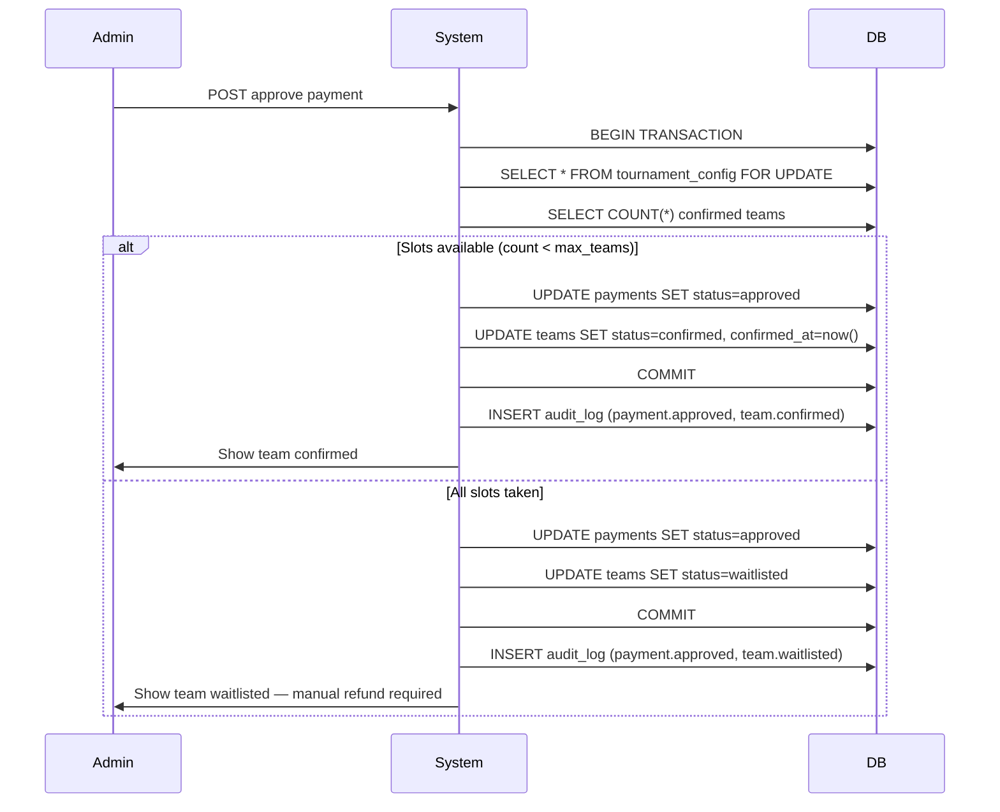

### 4.4 Batch Player Addition (Atomic DUPR + Capacity Check)

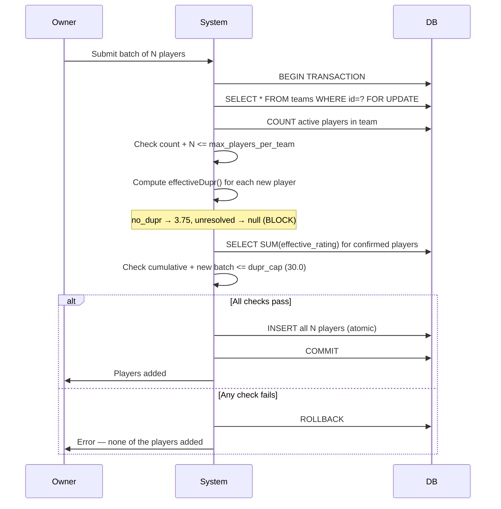

---

## 5. Domain Operations

### 5.1 `effectiveDupr(player)` — Rating Resolution

```
if rating_status == 'no_dupr'   → return 3.75
if rating_status == 'verified'  → return verified_rating
if rating_status == 'pending'   → return null   (UNRESOLVED — blocks confirmation)
if rating_status == 'disputed'  → return null   (UNRESOLVED — blocks confirmation)
```

A team with **any** active player returning `null` cannot pass DUPR validation.

### 5.2 `approvePayment(paymentId, adminId, note)` — Team Approval

```
1. Fetch payment record
2. Open transaction
3. LOCK tournament_config FOR UPDATE
4. Count confirmed teams
5. if count < max_teams:
     approve payment → confirm team
   else:
     approve payment → waitlist team
6. Write audit log
7. COMMIT
```

### 5.3 `addPlayersBatch(teamId, players[])` — Atomic Batch Add

```
1. Open transaction
2. LOCK teams row FOR UPDATE
3. Count active players (not removed/rejected)
4. Assert count + players.length <= max_players_per_team
5. For each player: resolve effectiveDupr()
6. Assert any player has null dupr → ROLLBACK with specific error
7. Assert (existing_sum + new_sum) <= dupr_cap → ROLLBACK if exceeded
8. INSERT all players
9. COMMIT
```

### 5.4 `generateRegistrationToken()` — Private Link

```
1. Generate crypto.randomUUID()
2. INSERT teams row with token, status=pending_payment
3. Return URL: /register/team?token=<uuid>
4. Token is single-use — mark token_used_at on first access
```

---

## 6. Route & Authorization Matrix

| Route | Public | Owner | Admin | Notes |
|---|---|---|---|---|
| `/` | ✅ | ✅ | ✅ | Tournament landing page |
| `/rules` | ✅ | ✅ | ✅ | Rules and eligibility |
| `/register/team?token=` | Token required | ✅ | ✅ | Token validated server-side |
| `/auth/login` | ✅ | — | ✅ | Admin email/password login |
| `/auth/callback` | ✅ | — | ✅ | Supabase OAuth callback |
| `/owner/dashboard` | ❌ | ✅ own only | ❌ | Redirect to login if no session |
| `/owner/teams/[teamId]` | ❌ | ✅ own team | ❌ | Server-side ownership check |
| `/admin` | ❌ | ❌ | ✅ | Check `admin_users` table |
| `/admin/payments` | ❌ | ❌ | ✅ | Check `admin_users` table |
| `/admin/teams/[teamId]` | ❌ | ❌ | ✅ | Check `admin_users` table |
| `/api/uploads` | ❌ | ✅ own team | ✅ | File type + size enforced |

Authorization is enforced **server-side** in middleware and Server Actions — not by hiding UI elements alone.

---

## 7. Security Architecture

### 7.1 Authentication Flows

```
Owner  → Private token link → Supabase Auth (email/password created at registration)
Admin  → /auth/login         → Supabase Auth (email/password)
                               → Server checks admin_users table
                               → Sets session cookie (HttpOnly)
```

### 7.2 Supabase Client Usage

| Context | Client | Key Used |
|---|---|---|
| Browser components | `lib/supabase/client.ts` | `NEXT_PUBLIC_SUPABASE_ANON_KEY` |
| Server Components / Actions | `lib/supabase/server.ts` | Anon key + session cookie |
| Admin mutations / audit writes | `lib/supabase/admin.ts` | `SUPABASE_SERVICE_ROLE_KEY` |

`SUPABASE_SERVICE_ROLE_KEY` is **never** referenced in any file that could be bundled for the browser. Enforced by Next.js — any `NEXT_PUBLIC_` prefix would expose it.

### 7.3 Payment Proof Storage

```
Bucket: payment-proofs          (private — no public URL)
Path:   <team_id>/<uuid>.<ext>

Access:
- Owner uploads via /api/uploads (server validates ownership)
- Admin retrieves via createSignedUrl() with 15-minute expiry
- Direct bucket URL never returned to browser
```

### 7.4 RLS Policy Summary

| Table | Owner Access | Admin Access | Public Access |
|---|---|---|---|
| `tournament_config` | Read | Full | Read |
| `admin_users` | None | Own row | None |
| `teams` | Own team | All | None |
| `players` | Own team's players | All | None |
| `payments` | Read + Insert own | All | None |
| `audit_logs` | None | Read | None |

Writes to `audit_logs` use service-role on the server — never from the browser.

### 7.5 File Upload Security

```
Allowed types:  image/jpeg, image/png, application/pdf
Max size:       2 MB
Validation:     MIME type checked server-side (not just extension)
Storage path:   UUID-named to prevent enumeration
Signed URLs:    15-minute expiry for admin review
```

---

## 8. Middleware Design

```typescript
// middleware.ts — route protection matrix

/owner/*  → require valid Supabase session
             (redirect to /auth/login if missing)

/admin/*  → require valid Supabase session
             + row in admin_users with status=active
             (redirect to /auth/login if missing or not admin)

/register/team → token presence check only
                  (full validation happens in page/server action)

All others → pass through
```

---

## 9. State Transition Diagrams

### 9.1 Team Status

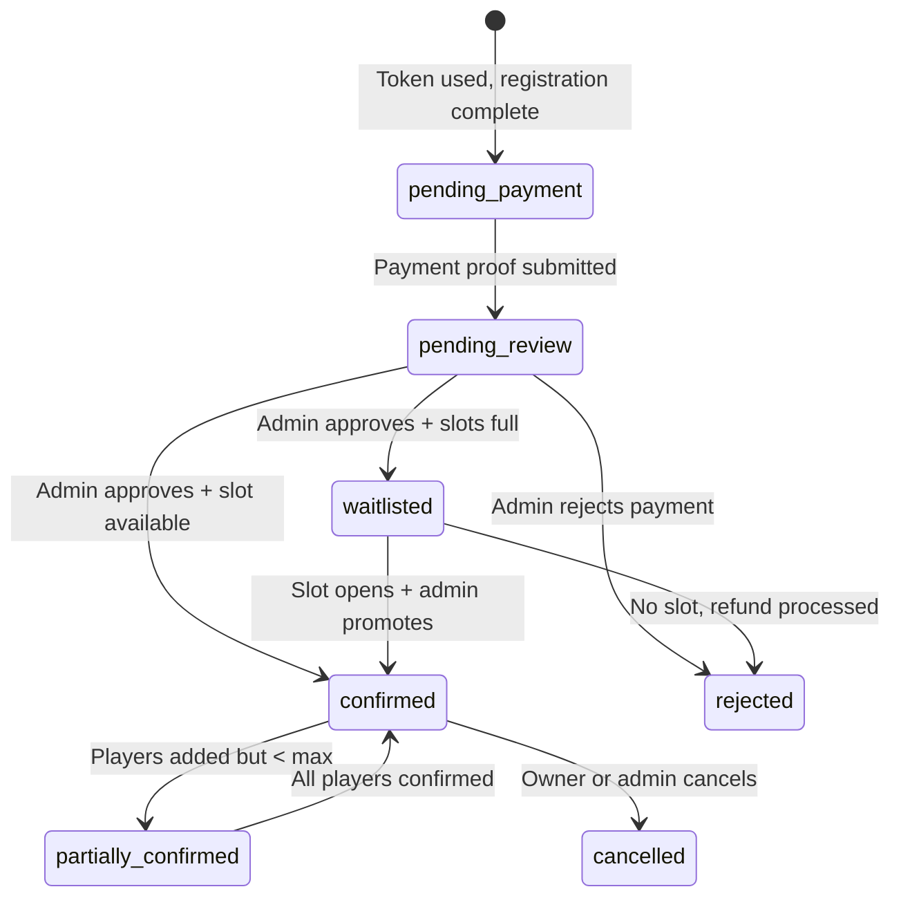

### 9.2 Player Status

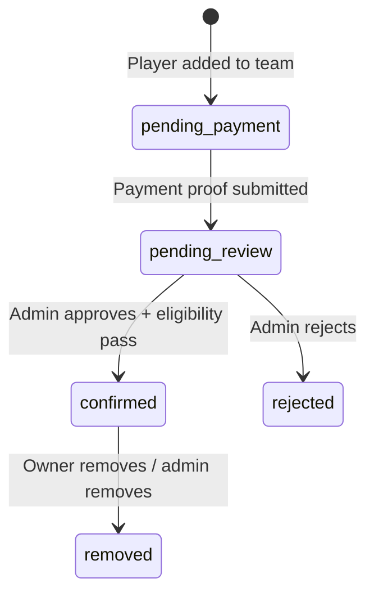

### 9.3 Payment Status

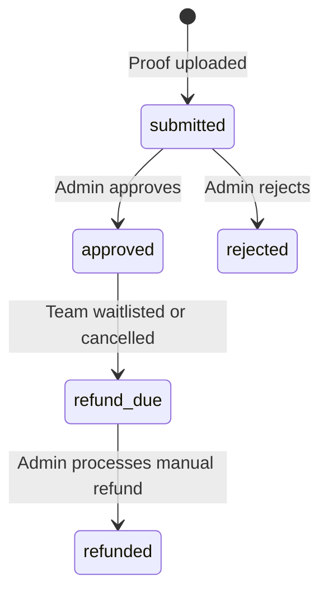

---

## 10. Key Architectural Decisions

### ADR-001: Private Token Links over Phone OTP

**Decision:** Use UUID-based private registration links instead of phone OTP.
**Reason:** DLT registration requirement for Indian SMS, provider cost uncertainty, and the small fixed team count (8) makes manual link distribution practical.
**Trade-off:** No self-serve sign-up; admin must generate and share each link. Acceptable for MVP scale.

### ADR-002: Modular Monolith with Domain Boundaries

**Decision:** Single Next.js app with explicit domain folders (`lib/domain/`) rather than microservices.
**Reason:** 8 teams is not a scale problem. Explicit boundaries allow extraction later without a rewrite.
**Trade-off:** All domains share one deployment. Acceptable until post-MVP.

### ADR-003: Atomic DB Transactions for Capacity

**Decision:** All capacity-altering operations (team approval, batch player add) use `SELECT ... FOR UPDATE` within a transaction.
**Reason:** Prevents overbooking under concurrent admin actions. Cannot rely on application-layer checks alone.
**Trade-off:** Slightly higher DB lock contention. Acceptable at this scale.

### ADR-004: `tournament_config` as Configurable Singleton

**Decision:** All limits (`max_teams`, fees, DUPR cap) stored in DB, not hardcoded.
**Reason:** Allows increasing team count or changing fees without a code deployment.
**Trade-off:** One extra DB read on capacity-check operations. Cached in transaction anyway.

### ADR-005: Service-Role Writes for Audit Logs

**Decision:** `audit_logs` inserts use the service-role client on the server only.
**Reason:** RLS cannot be bypassed by users; logs are tamper-resistant from the browser.
**Trade-off:** Audit writes must always go through server — no client-side audit calls.

### ADR-006: Admin Auth via Supabase Email/Password + `admin_users` Table

**Decision:** Admins authenticate through Supabase Auth (email/password) with a separate `admin_users` table for role/status.
**Reason:** Supabase handles secure password hashing and sessions. The `admin_users` table adds role management without building custom auth.
**Trade-off:** Admin provisioning is manual (insert row into `admin_users`). Acceptable for a small admin team.

---

## 11. Deployment Architecture

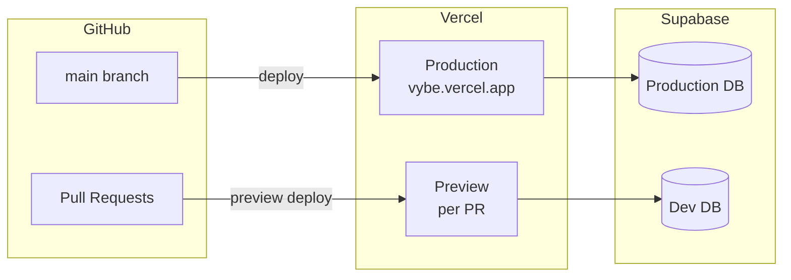

**Environment variables per environment:**

| Variable | Dev | Production |
|---|---|---|
| `NEXT_PUBLIC_SUPABASE_URL` | Dev project URL | Prod project URL |
| `NEXT_PUBLIC_SUPABASE_ANON_KEY` | Dev anon key | Prod anon key |
| `SUPABASE_SERVICE_ROLE_KEY` | Dev service key | Prod service key |
| `SUPABASE_PAYMENT_BUCKET` | `payment-proofs` | `payment-proofs` |

---

## 12. Out of Scope (MVP)

The following are **explicitly deferred** — do not build now:

| Feature | Reason Deferred |
|---|---|
| Automatic payment gateway | Manual UPI review sufficient for 8 teams |
| Automatic DUPR API integration | Manual admin verification sufficient |
| Fixture generation | Post-MVP (Milestone 5) |
| Live scoring / leaderboard | Post-MVP (Milestone 5) |
| Multi-tournament support | Post-MVP (Milestone 6) |
| Public player profiles | Post-MVP |
| Email notifications | Could be added in Milestone 4 pre-launch |
| Phone OTP auth | Deferred (ADR-001) |

---

## 13. Milestone → Component Mapping

| Milestone | Components Built |
|---|---|
| M0 — Policy | Decisions only, no code |
| M1 — Foundation | DB migrations, Supabase setup, `lib/supabase/`, types |
| M2 — Team Registration | `lib/tokens.ts`, `/register/team`, `/owner/*`, `/api/uploads`, `lib/domain/teams.ts`, `lib/domain/payments.ts`, admin payment queue |
| M3 — Player Registration | `lib/domain/players.ts`, `lib/domain/ratings.ts`, player UI under `/owner/teams/[teamId]`, admin player review |
| M4 — Admin & Launch | Admin dashboard polish, authorization tests, concurrent tests, mobile pass |
| M5+ | Tournament engine (separate domain) |
